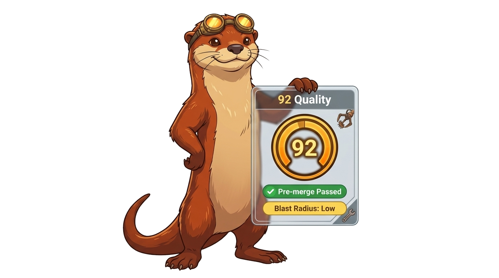
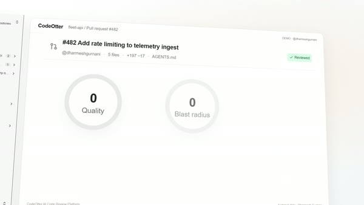
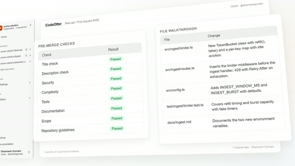
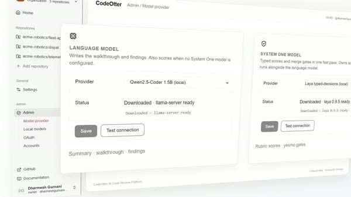
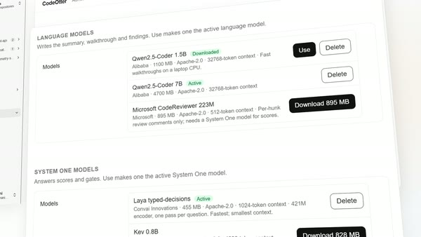

<div align="center">

<p align="center">
  
</p>

# 🦦 CodeOtter

### CodeOtter is the self-hosted AI pull request reviewer with 6 calibrated 0–100 gauges (`Quality`, `Blast Radius`, `Risk`, `Tests`, `Readability`, `PR Hygiene`), 9 binary merge gates (`Title`, `Description`, `Security`, `Complexity`, `Tests`, `Docs`, `Scope`, `Guidelines`, `Issue Requirements`), and a `POST /v1/systemone` deterministic System 1 engine — free to self-host under AGPL-3.0.

<p align="center">
  <a href="https://codeotter.io"><strong>Website</strong></a> &middot;
  <a href="https://docs.codeotter.io/docs"><strong>Docs</strong></a> &middot;
  <a href="#-quickstart"><strong>Quickstart</strong></a> &middot;
  <a href="#what-is-codeotter"><strong>What is CodeOtter</strong></a> &middot;
  <a href="https://docs.codeotter.io/docs/dual-engine"><strong>Dual Engine</strong></a> &middot;
  <a href="https://docs.codeotter.io/docs/local-gguf-sidecar"><strong>Offline Mode</strong></a> &middot;
  <a href="https://docs.codeotter.io/docs/docker-quickstart"><strong>Docker</strong></a> &middot;
  <a href="https://docs.codeotter.io/docs/security"><strong>Security & Privacy</strong></a> &middot;
  <a href="#-star-history"><strong>Star History</strong></a>
</p>

<p align="center">
  <a href="https://github.com/dharmeshgurnani/CodeOtter/actions/workflows/ci.yml"></a>
  <a href="https://codeotter.io"></a>
  <a href="https://docs.codeotter.io/docs"></a>
  <a href="LICENSE"></a>
  <a href="package.json"></a>
  <a href="https://docs.codeotter.io/docs/security"></a>
  <a href="#what-is-codeotter"></a>
  <a href="https://docs.codeotter.io/docs/local-gguf-sidecar"></a>
  <a href="https://star-history.com/#dharmeshgurnani/CodeOtter&Date"></a>
</p>

</div>

---

## What is CodeOtter?

**CodeOtter** is a free-to-self-host pull request review platform built for engineering teams who want calibrated code intelligence without sending private code to third-party SaaS clouds or paying **$24–$30/developer/month**.

Run it **100% offline** on your workstation with open-weight Hugging Face models (`llama.cpp` + `ggmlc` sidecars), or connect your own keys for Claude, OpenAI, MiniMax, or OpenRouter.

<p align="center">
  <a href="assets/videos/codeotter-cinematic-film-silent.mp4"><picture><source srcset="assets/videos/hero-showcase.gif" type="image/gif"></picture></a>
</p>

---

## Features

<table>
<tr>
<td width="50%" valign="middle">

### Side-by-Side 30/70 Review Dashboard

Inspect calibrated **0–100 score gauges** (`Quality`, `Blast Radius`, `Risk`, `Tests`, `Readability`, `PR Hygiene`) on the left while reading the streaming **Markdown review terminal**, interactive **Architecture & Blast Radius Mermaid diagram** (100% offline SVG flowchart renderer with raw Mermaid source toggle), cohort file walkthroughs, and severity-ranked findings on the right. Re-run scores or narrative independently with one click.

[Quickstart →](#-quickstart)

</td>
<td width="50%">
  <a href="assets/videos/codeotter-cinematic-film-silent.mp4"><picture><source srcset="assets/videos/tile-review-dashboard.gif" type="image/gif"></picture></a>
</td>
</tr>
<tr>
<td width="50%" valign="middle">

### Deterministic System 1 Scores &amp; Merge Gates

Standard LLM prompts hallucinate numbers. CodeOtter pairs your language model with a **System 1 decision engine** (`POST /v1/systemone`) that evaluates **6 rubric scores** and **9 yes/no pre-merge gates** (`Title`, `Description`, `Security`, `Complexity`, `Tests`, `Docs`, `Scope`, `Guidelines`) in a single fast pass.

[Dual Engine Architecture →](https://docs.codeotter.io/docs/dual-engine)

</td>
<td width="50%">
  <a href="assets/videos/codeotter-cinematic-film-silent.mp4"><picture><source srcset="assets/videos/tile-system-one.gif" type="image/gif"></picture></a>
</td>
</tr>
<tr>
<td width="50%" valign="middle">

### 100% Offline Local Models

Download open-weight GGUF and CodeT5 checkpoints directly from Hugging Face inside **Settings → System → Local models**. CodeOtter automatically manages `llama-server` (`llama.cpp`), `laya` (`ggmlc`), and Python sidecars with discrete Vulkan/Metal GPU detection.

[Offline Mode →](https://docs.codeotter.io/docs/local-gguf-sidecar)

</td>
<td width="50%">
  <a href="assets/videos/codeotter-cinematic-film-silent.mp4"><picture><source srcset="assets/videos/tile-local-models.gif" type="image/gif"></picture></a>
</td>
</tr>
<tr>
<td width="50%" valign="middle">

### `AGENTS.md` / `CLAUDE.md`, Repo Learnings, Inline `suggestion` Fixes, Incremental Delta Reviews &amp; GitHub PR Sync

Automatically detects `AGENTS.md` and `CLAUDE.md` at the root of each onboarded repository and enforces them at the merge gate. Smart outside-diff context, a self-check pass on every finding, PR tools (Describe, Ask, Improve, Docs, Changelog), `/review`-style PR comment commands, team learnings, accepted fixes, incremental delta reviews, and committable inline `suggestion` fixes posted to the pull request and updated in place.

[Review features →](https://docs.codeotter.io/docs/review-features)


</td>
<td width="50%">
  <a href="assets/videos/codeotter-cinematic-film-silent.mp4"><picture><source srcset="assets/videos/tile-github-sync.gif" type="image/gif"></picture></a>
</td>
</tr>
</table>

---

## Supported Models &amp; Providers

Works with **any local open-weight model or hosted API** — mix and match System 1 and System 2 engines freely.

<p>
  <a href="https://huggingface.co/Anthropic"><kbd> Claude Opus / Sonnet</kbd></a> &nbsp;
  <a href="https://huggingface.co/openai"><kbd> OpenAI GPT-5</kbd></a> &nbsp;
  <a href="https://huggingface.co/Qwen"><kbd> Qwen2.5-Coder (1.5B / 7B)</kbd></a> &nbsp;
  <a href="https://huggingface.co/MiniMaxAI"><kbd> MiniMax-M3</kbd></a> &nbsp;
  <a href="https://huggingface.co/deepseek-ai"><kbd> DeepSeek-Coder / V3</kbd></a> &nbsp;
  <a href="https://huggingface.co/meta-llama"><kbd> Llama 3.1 / 3.3</kbd></a> &nbsp;
  <a href="https://huggingface.co/microsoft/codereviewer"><kbd> Microsoft CodeReviewer</kbd></a> &nbsp;
  <a href="https://huggingface.co/mys/laya-typed-decisions-GGUF"><kbd> Laya Typed-Decisions</kbd></a> &nbsp;
  <a href="https://huggingface.co/mys/kev-0.8b-GGUF"><kbd> Kev 0.8B (S1)</kbd></a> &nbsp;
  <a href="https://console.typesafe.ai"><kbd> TypeSafe Jev</kbd></a> &nbsp;
  <a href="https://openrouter.ai/cloudflare/clef"><kbd> Cloudflare Clef</kbd></a> &nbsp;
  <a href="https://ollama.com"><kbd> Ollama</kbd></a> &nbsp;
  <a href="https://openrouter.ai"><kbd> OpenRouter</kbd></a> &nbsp;
  <kbd>+ any OpenAI-compatible or local GGUF endpoint</kbd>
</p>

---

## CodeOtter is right for your team if

- ✅ You want **enterprise-grade PR reviews** without sending private code to a third-party cloud
- ✅ You want **calibrated 0–100 scores and deterministic gates**, not hallucinated guesses
- ✅ You want to **enforce team conventions** (`AGENTS.md` / `CLAUDE.md`) automatically on every PR
- ✅ You want to run **100% offline on local hardware** (MacBook, Linux workstation, air-gapped GPU)
- ✅ You want **zero per-seat billing** ($0 forever for self-hosting)
- ✅ You want an **instant, zero-dependency deployment** with Docker or lightweight Node

---

## ⚡ Quickstart

Requires Node 22+ and pnpm. For GitHub repositories, authenticate the GitHub CLI (`gh auth status`).

```bash
git clone https://github.com/dharmeshgurnani/CodeOtter.git
cd CodeOtter
pnpm dev      # http://localhost:5173 (or pnpm start for production on :4747)
```

Or deploy with Docker on any Linux server:

```bash
curl -fsSL https://raw.githubusercontent.com/dharmeshgurnani/CodeOtter/main/bin/install.sh | bash
```

[](https://portal.azure.com/#create/Microsoft.Template/uri/https%3A%2F%2Fraw.githubusercontent.com%2Fdharmeshgurnani%2FCodeOtter%2Fmain%2Fbin%2Fdeploy%2Fazure.json)
[](https://render.com/deploy?repo=https://github.com/dharmeshgurnani/CodeOtter)

The full setup guides are in the **[Quickstart](https://docs.codeotter.io/docs/quickstart)** and **[Docker quickstart](https://docs.codeotter.io/docs/docker-quickstart)**.

---

## 📚 Documentation

All documentation lives at **[docs.codeotter.io](https://docs.codeotter.io/docs)** ([source](https://github.com/dharmeshgurnani/codeotter-docs)).

| Topic | Guide |
| :--- | :--- |
| Run locally | [Quickstart](https://docs.codeotter.io/docs/quickstart) |
| Deploy | [Docker quickstart](https://docs.codeotter.io/docs/docker-quickstart) · [Accounts and roles](https://docs.codeotter.io/docs/accounts-and-roles) |
| Models | [BYOK provider config](https://docs.codeotter.io/docs/byok-config) · [Local GGUF & sidecars (100% offline)](https://docs.codeotter.io/docs/local-gguf-sidecar) |
| Git providers | [Forgejo](https://docs.codeotter.io/docs/forgejo) · [Gitea](https://docs.codeotter.io/docs/gitea) |
| Reviews | [Dual engine](https://docs.codeotter.io/docs/dual-engine) · [Review features](https://docs.codeotter.io/docs/review-features) · [`AGENTS.md` / `CLAUDE.md`](https://docs.codeotter.io/docs/repository-guidelines) · [Fast triage in CI](https://docs.codeotter.io/docs/ci-triage) |
| Terminal | [CLI, TUI & MCP server](https://docs.codeotter.io/docs/cli) |
| Reference | [Security & privacy](https://docs.codeotter.io/docs/security) · [Development & integration tests](https://docs.codeotter.io/docs/development) |

---

## ⭐ Star History

<p align="center">
  <a href="https://star-history.com/#dharmeshgurnani/CodeOtter&Date">
    <picture>
      <source media="(prefers-color-scheme: dark)" srcset="https://api.star-history.com/svg?repos=dharmeshgurnani/CodeOtter&type=Date&theme=dark" />
      <source media="(prefers-color-scheme: light)" srcset="https://api.star-history.com/svg?repos=dharmeshgurnani/CodeOtter&type=Date" />
      
    </picture>
  </a>
</p>

---

## 📄 License & Community

- **License**: Open source under the [GNU AGPL-3.0](LICENSE). Free to self-host, modify and redistribute; anyone who runs a modified version as a network service must publish their changes.
- **Contributing**: Contributions and feedback are welcome! Please check out [`CONTRIBUTING.md`](CONTRIBUTING.md) to get started.
